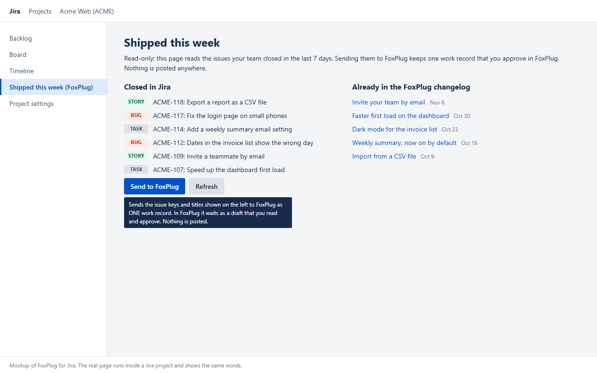
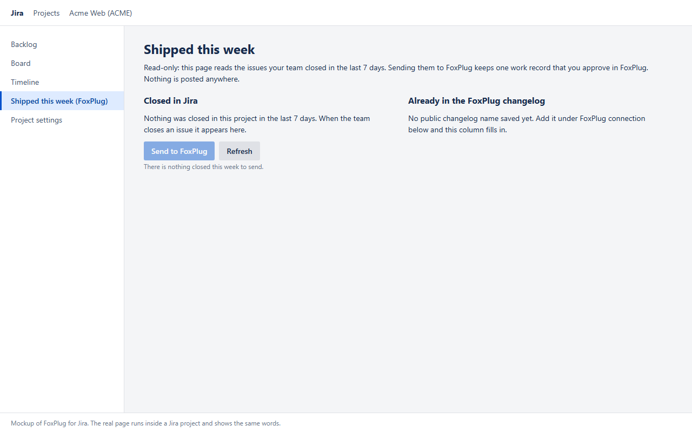
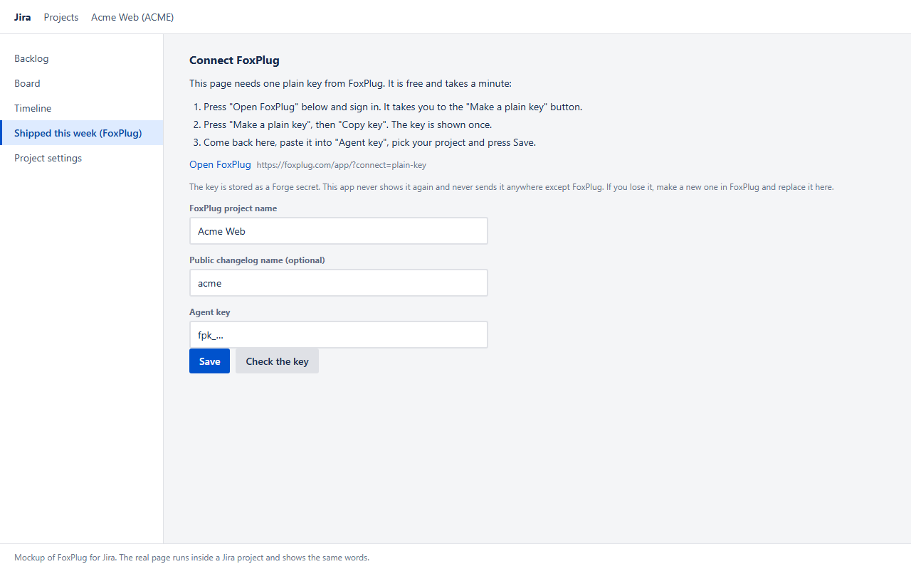
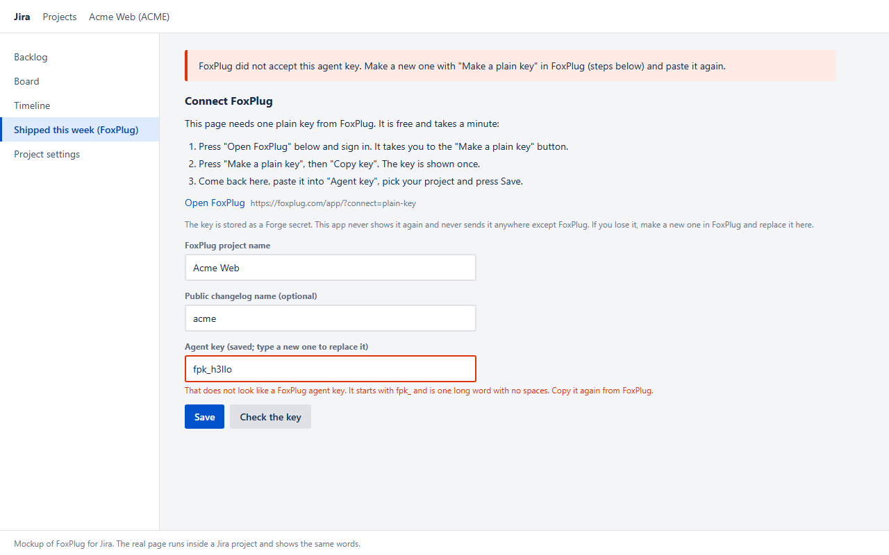
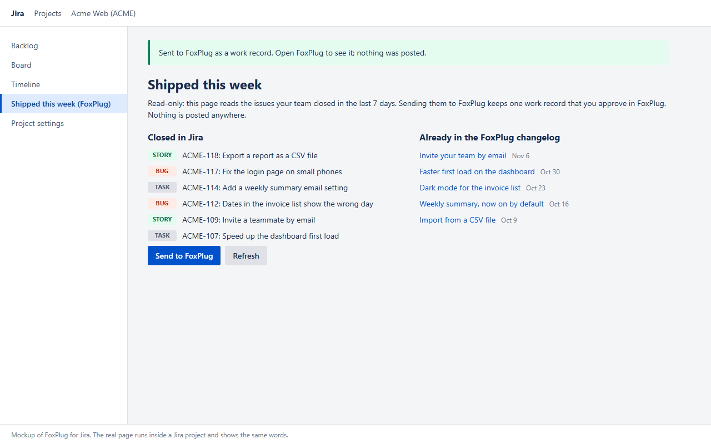
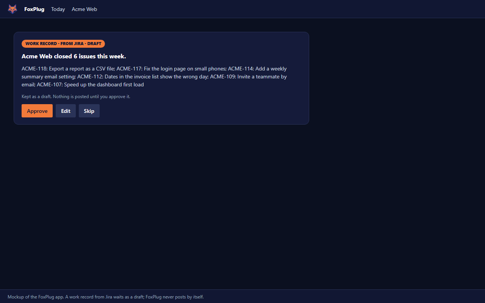

# FoxPlug for Jira: Shipped this week

Turn the tickets your team closed into what you tell your customers.

FoxPlug for Jira adds one page to a Jira project, **Shipped this week (FoxPlug)**. It lists the issues the project closed in the last seven days, shows what the project's public FoxPlug changelog already says beside them, and has one button that sends the closed issues to [FoxPlug](https://foxplug.com) as a single work record. In FoxPlug the record waits as a draft that you read, edit and approve. Nothing is posted anywhere by this app, and FoxPlug never posts by itself.

Built for the Atlassian Codegeist 2026 hackathon (category: Apps for Software Teams) on Forge, with a Jira project page (UI Kit) and one resolver.



## What it does

- **Closed in Jira**: the issues closed in the last 7 days, newest first (key, title, type), read with the Jira API.
- **Already in the FoxPlug changelog**: the last five entries of the project's public changelog at `https://foxplug.com/feed/<name>.json`, so the team sees what the outside world was already told.
- **Send to FoxPlug**: one work record with the issue keys and titles, nothing else.
- **Check the key**: asks FoxPlug whether the saved key works. Nothing is sent and nothing is created.
- Calm states everywhere: loading lines, an empty state for each column, plain sentences for every error (no codes), a hover help text on every control.

| | |
|---|---|
| Nothing closed this week |  |
| Connect FoxPlug |  |
| A key FoxPlug did not accept |  |
| Sent |  |
| The draft waiting in FoxPlug |  |

These images are mockups rendered from the app's own wording (`npm run mockups`); the real page runs inside a Jira project and shows the same words.

## Install and try it

1. Open the install link from the Devpost submission, install the app on your Jira site, and open any Jira project.
2. Choose **Shipped this week (FoxPlug)** in the project sidebar. The closed issues appear with no setup.
3. To try **Send to FoxPlug** you need a free FoxPlug account and a plain key. Setup is three lines:
   1. On the Jira page, open **Connect FoxPlug** and press **Open FoxPlug**. It lands on the **Make a plain key** button (https://foxplug.com/app/?connect=plain-key).
   2. Press **Make a plain key**, then **Copy key**. It is shown once.
   3. Back in Jira, paste it into **Agent key**, pick your project, press **Save**. Press **Check the key** to confirm.
4. Press **Send to FoxPlug**, then open FoxPlug: the work record is waiting as a draft.

## What the app can see and send

| | |
|---|---|
| Jira permission | `read:jira-work` only. The app never writes to Jira. |
| App storage | `storage:app`: the FoxPlug project name, the optional changelog name, and the agent key as a **Forge secret** (never shown again, never returned to the page, never logged). |
| Outside address | One: `foxplug.com`. |
| What is sent | For Send: the project's display name, and for each closed issue its key and title. Not sent: assignees, reporters, descriptions, comments, attachments, custom fields. |
| What is not done | No posting, no emails, no writing to Jira, no other network calls. |

## Develop

```
npm install
npm test            # 32 tests: the pure logic, every message, and static checks on the page and resolver
npm run validate:manifest   # checks manifest.yml offline
npm run mockups     # rebuilds assets/mockups/*.html and assets/screens/*.png (needs Playwright)
```

- `manifest.yml`: a `jira:projectPage` module with `render: native` (UI Kit) and a resolver function. It validates offline with the schema package the Forge CLI uses.
- `src/lib.js`: all logic and all wording as pure functions, so they are tested without Atlassian.
- `src/index.js`: the resolver (`getShipped`, `getSettings`, `saveSettings`, `getFoxPlugFeed`, `checkKey`, `sendToFoxPlug`). Every resolver is wrapped so a failure returns one plain sentence.
- `src/frontend/index.jsx`: the UI Kit page.

Deploy with the Forge CLI: `forge register`, `forge lint`, `forge deploy -e production`, `forge install --site <your-site>.atlassian.net --product jira -e production`. The Forge CLI needs Node.js 22.23 or newer.

## License

MIT. See `LICENSE`.
